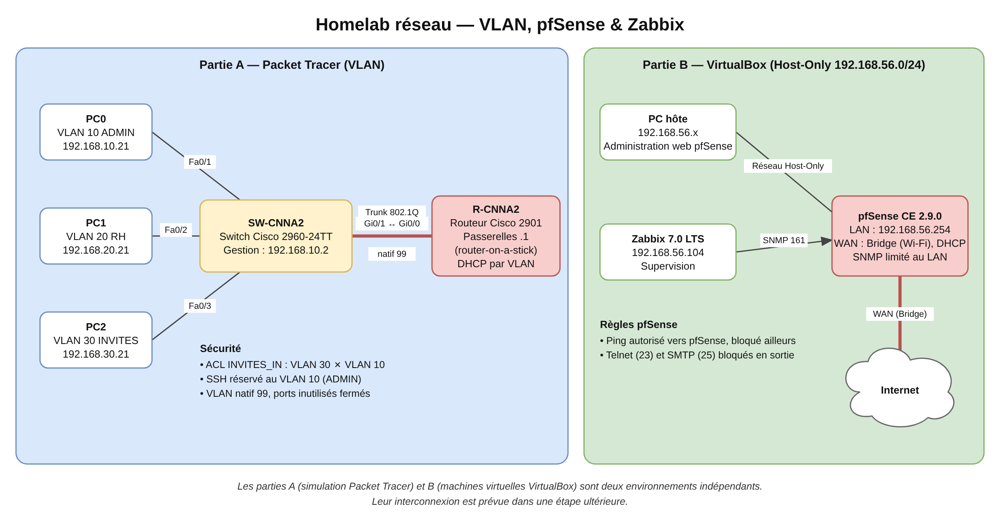

# Homelab réseau — VLAN, pfSense & Zabbix

Projet personnel mené en parallèle de ma formation Cisco NetAcad (parcours CCNA) : plutôt que de me limiter à la théorie et aux quiz, j'ai construit un petit réseau avec ses VLAN, son pare-feu et sa supervision, en documentant chaque étape, y compris les erreurs.

**Navigation :** Accueil · [Partie A — VLAN](docs/partie-a-vlan.md) · [Partie B — pfSense et Zabbix](docs/partie-b-pfsense-zabbix.md) · [Adressage](docs/plan-adressage.md) · [Règles pfSense](docs/regles-pfsense.md) · [Tests et supervision](docs/tests-et-supervision.md) · [Problèmes résolus](docs/problemes-resolus.md) · [Feuille de route](docs/feuille-de-route.md)

## Par où commencer ?

| Je veux… | Aller à |
|---|---|
| Comprendre le projet en deux minutes | Cette page |
| Voir les VLAN et le routage inter-VLAN | [Partie A](docs/partie-a-vlan.md) |
| Voir le pare-feu et la supervision | [Partie B](docs/partie-b-pfsense-zabbix.md) |
| Retrouver les adresses IP | [Adressage](docs/plan-adressage.md) |
| Voir comment j'ai résolu des problèmes | [Problèmes résolus](docs/problemes-resolus.md) |
| Savoir ce qui vient ensuite | [Feuille de route](docs/feuille-de-route.md) |

## Le projet en un coup d'œil

Le lab est composé de **deux parties qui ne sont pas encore reliées entre elles**. Les relier est le prochain objectif, décrit dans la [feuille de route](docs/feuille-de-route.md).

## Où en est le projet

| Élément | État |
|---|---|
| VLAN, routage inter-VLAN, DHCP et ACL (Packet Tracer) | Réalisé et testé |
| Installation et sécurisation de pfSense | Réalisé |
| Supervision de pfSense par Zabbix via SNMP | Réalisé |
| Durcissement du switch et du routeur (SSH restreint au VLAN 10, ports inutilisés coupés) | Réalisé et testé |
| [Règles de filtrage pfSense](docs/regles-pfsense.md) (Telnet/SMTP bloqués, ping encadré, journalisation) | Réalisé et testé |
| SNMP durci (chaîne personnalisée, écoute limitée au LAN) | Réalisé |
| [Tests](docs/tests-et-supervision.md), tableau de bord et alerte Zabbix (PROBLEM puis RESOLVED) | Réalisé |
| [Plan d'adressage](docs/plan-adressage.md) | Réalisé (réservation DHCP de Zabbix à faire) |
| Configurations exportées sans secret ([`configs/`](configs/)) | Réalisé |
| Ping de Zabbix vers Internet | Constaté, cause non confirmée (voir [Problèmes](docs/problemes-resolus.md)) |
| Alerte sur la charge CPU | Non faite dans cette version |
| Test de résolution DNS depuis le LAN | À faire |
| Liaison entre la partie A et la partie B | À faire |

## Rapport complet

Le rapport détaillé, avec le contexte, les configurations complètes, les tests de validation et le déroulé du dépannage, est disponible ici : [rapport/rapport-homelab-v1.pdf](rapport/rapport-homelab-v1.pdf) (23 pages : architecture, configurations, tests, problèmes rencontrés)

Contexte et objectifs

Je suis étudiant en cycle ingénieur, actuellement sur le module 2 du parcours CCNA de Cisco NetAcad (« Switching, Routing and Wireless Essentials »), avec l'objectif de terminer le module 3 et de passer l'examen CCNA, puis CompTIA Security+. Ce homelab est pensé pour grandir avec ma formation, et pour me donner un vrai projet concret à présenter en entretien plutôt qu'une simple liste de certifications.

Ce que je voulais accomplir avec cette première phase :

- Mettre en pratique la segmentation réseau avec des VLAN
- Configurer un routage inter-VLAN (router-on-a-stick) sur un routeur Cisco
- Ajouter un pare-feu réel pour sécuriser le réseau (pfSense)
- Mettre en place une supervision pour surveiller l'infrastructure (Zabbix)
- Garder une trace précise de chaque étape, y compris des erreurs rencontrées en cours de route

Outils utilisés

- Cisco Packet Tracer, pour la partie VLAN, routage inter-VLAN, DHCP et ACL
- VirtualBox, comme hyperviseur pour pfSense et Zabbix
- pfSense CE 2.9.0, en tant que pare-feu et routeur de bordure
- Zabbix 7.0 LTS, pour la supervision réseau via SNMP
- GNS3, installé et fonctionnel, prévu pour une prochaine extension du lab

