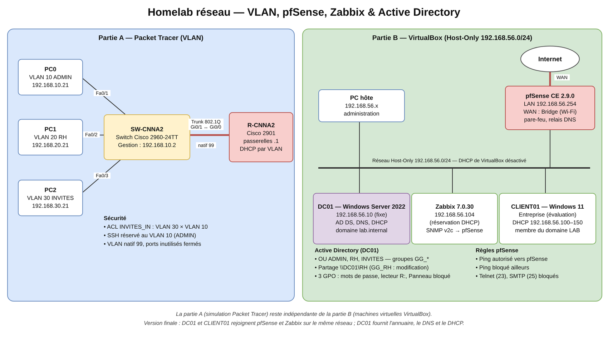

# Homelab réseau — VLAN, pfSense, Zabbix & Active Directory

Projet personnel mené en parallèle de ma formation Cisco NetAcad (parcours CCNA) : plutôt que de me limiter à la théorie et aux quiz, j'ai construit un petit réseau avec ses VLAN, son pare-feu, sa supervision et un domaine Active Directory, en documentant chaque étape, y compris les erreurs.

**Navigation :** Accueil · [Partie A — VLAN](docs/partie-a-vlan.md) · [Partie B — pfSense et Zabbix](docs/partie-b-pfsense-zabbix.md) · [Partie C — Windows Server](docs/partie-c-windows-server.md) · [Adressage](docs/plan-adressage.md) · [Règles pfSense](docs/regles-pfsense.md) · [Tests et supervision](docs/tests-et-supervision.md) · [Problèmes résolus](docs/problemes-resolus.md) · [Feuille de route](docs/feuille-de-route.md)

## Par où commencer ?

| Je veux… | Aller à |
|---|---|
| Comprendre le projet en deux minutes | Cette page |
| Voir les VLAN et le routage inter-VLAN | [Partie A](docs/partie-a-vlan.md) |
| Voir le pare-feu et la supervision | [Partie B](docs/partie-b-pfsense-zabbix.md) |
| Voir Active Directory, le DHCP Windows et les GPO | [Partie C](docs/partie-c-windows-server.md) |
| Retrouver les adresses IP | [Adressage](docs/plan-adressage.md) |
| Voir comment j'ai résolu des problèmes | [Problèmes résolus](docs/problemes-resolus.md) |
| Savoir ce qui vient ensuite | [Feuille de route](docs/feuille-de-route.md) |

## Le projet en un coup d'œil

Le lab comporte trois volets. La **partie A** (Packet Tracer) simule les VLAN et le routage inter-VLAN. Dans VirtualBox, la **partie B** (pfSense et Zabbix) et la **partie C** (contrôleur de domaine Windows Server et poste client Windows 11) partagent le même réseau : DC01 y fournit l'annuaire, le DNS et le DHCP. La partie A n'est pas encore reliée au reste ; c'est un objectif de la [feuille de route](docs/feuille-de-route.md).

## Où en est le projet

| Élément | État |
|---|---|
| VLAN, routage inter-VLAN, DHCP et ACL (Packet Tracer) | Réalisé et testé |
| Installation et sécurisation de pfSense | Réalisé |
| Supervision de pfSense par Zabbix via SNMP | Réalisé |
| Durcissement du switch et du routeur (SSH restreint au VLAN 10, ports inutilisés coupés) | Réalisé et testé |
| [Règles de filtrage pfSense](docs/regles-pfsense.md) (Telnet/SMTP bloqués, ping encadré, journalisation) | Réalisé et testé |
| SNMP durci (chaîne personnalisée, écoute limitée au LAN) | Réalisé |
| [Tests](docs/tests-et-supervision.md), tableau de bord et alerte Zabbix (PROBLEM puis RESOLVED) | Réalisé |
| [Plan d'adressage](docs/plan-adressage.md) | Réalisé (réservation DHCP de Zabbix faite sur DC01) |
| Configurations exportées sans secret ([`configs/`](configs/)) | Réalisé |
| [Contrôleur de domaine DC01](docs/partie-c-windows-server.md) : AD DS, DNS, domaine `lab.internal` | Réalisé |
| DHCP basculé de pfSense vers DC01, réservation de Zabbix | Réalisé et vérifié |
| OU, groupes, utilisateurs et partage `\\DC01\RH` (moindre privilège) | Réalisé |
| 3 GPO (mot de passe, lecteur R:, Panneau de configuration bloqué) | Réalisé et testé sur un client Windows 11 joint au domaine |
| Commandes PowerShell de la partie C ([`scripts/windows-server/`](scripts/windows-server/)) | Réalisé |
| Test du verrouillage de compte après 5 échecs | Configuré, non testé |
| Supervision de DC01 et du client dans Zabbix | À faire |
| Ping de Zabbix vers Internet | Sans réponse avant la règle de blocage ICMP, cause non confirmée ; désormais bloqué volontairement (voir [Problèmes](docs/problemes-resolus.md)) |
| Alerte sur la charge CPU | À faire |
| Résolution DNS depuis le LAN | Noms internes testés (`dc01.lab.internal` depuis le client) ; noms Internet via le redirecteur à tester |
| Liaison entre la partie A (Packet Tracer) et le réseau VirtualBox | À faire |

## Rapport complet

Le rapport détaillé, avec le contexte, les configurations complètes, les tests de validation et le déroulé du dépannage, est disponible ici : [rapport/rapport-homelab-final.pdf](rapport/rapport-homelab-final.pdf) (42 pages : architecture, configurations, Windows Server et Active Directory, tests, 13 problèmes rencontrés, annexe des commandes).

Version précédente, sans la partie Windows Server : [rapport/rapport-homelab-v1.pdf](rapport/rapport-homelab-v1.pdf).

Contexte et objectifs

Je suis étudiant en cycle ingénieur et je suis le parcours CCNA de Cisco NetAcad, avec l'objectif de passer l'examen CCNA, puis CompTIA Security+. Ce homelab est pensé pour grandir avec ma formation, et pour me donner un vrai projet concret à présenter en entretien plutôt qu'une simple liste de certifications.

Ce que je voulais accomplir :

- Mettre en pratique la segmentation réseau avec des VLAN
- Configurer un routage inter-VLAN (router-on-a-stick) sur un routeur Cisco
- Ajouter un pare-feu réel pour sécuriser le réseau (pfSense)
- Mettre en place une supervision pour surveiller l'infrastructure (Zabbix)
- Centraliser les comptes, le DNS et le DHCP avec Active Directory, et appliquer des stratégies de groupe vérifiées sur un vrai poste client
- Garder une trace précise de chaque étape, y compris des erreurs rencontrées en cours de route

Outils utilisés

- Cisco Packet Tracer, pour la partie VLAN, routage inter-VLAN, DHCP et ACL
- VirtualBox, comme hyperviseur pour pfSense, Zabbix, Windows Server et le client Windows
- pfSense CE 2.9.0, en tant que pare-feu et routeur de bordure
- Zabbix 7.0 LTS, pour la supervision réseau via SNMP
- Windows Server 2022 (évaluation) : Active Directory, DNS, DHCP, stratégies de groupe, administré en PowerShell
- Windows 11 Entreprise (évaluation), comme poste client joint au domaine
- GNS3, installé et fonctionnel, prévu pour une prochaine extension du lab

