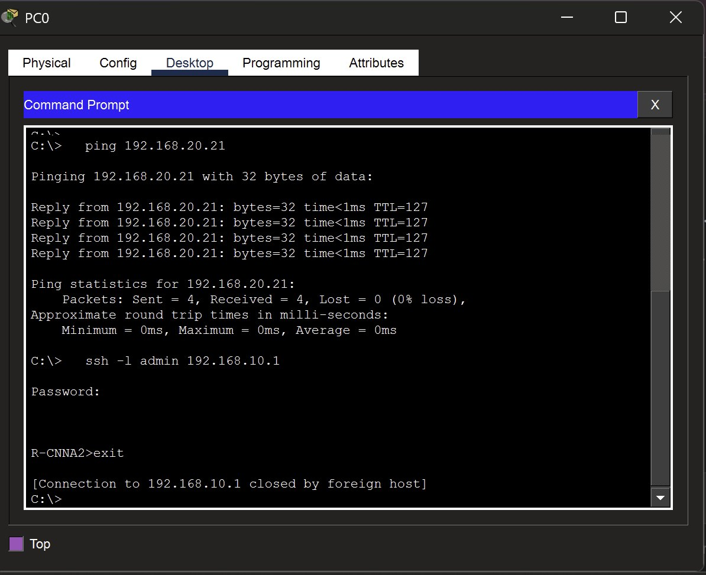
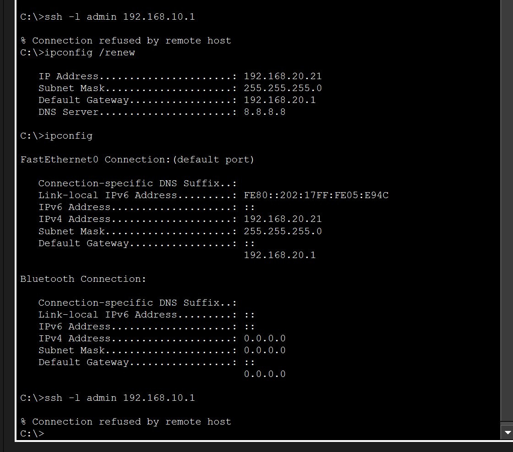

# Partie A — VLAN et routage inter-VLAN (Packet Tracer)

**Navigation :** [Accueil](../README.md) · Partie A · [Partie B](partie-b-pfsense-zabbix.md) · [Adressage](plan-adressage.md) · [Règles pfSense](regles-pfsense.md) · [Tests et supervision](tests-et-supervision.md) · [Problèmes résolus](problemes-resolus.md) · [Feuille de route](feuille-de-route.md)

> **En bref** : trois VLAN sur un switch Cisco 2960-24TT, un routage inter-VLAN assuré par un routeur 2901 (router-on-a-stick), un serveur DHCP par VLAN, et une ACL qui isole le VLAN Invités du VLAN Admin.

## Topologie

Trois PC sont connectés à un switch, chacun sur un VLAN différent. Le switch est relié au routeur par un lien trunk en 802.1Q, et c'est le routeur qui gère le routage entre les trois réseaux :

```
PC0 (VLAN 10, ADMIN) ──┐
PC1 (VLAN 20, RH)    ──┼── Switch SW-CNNA2 ── trunk 802.1Q ── Routeur R-CNNA2
PC2 (VLAN 30, INVITES)─┘
```

Les adresses de chaque VLAN sont dans la page [Adressage](plan-adressage.md).

**Topologie réseau complète** — 3 PC répartis sur 3 VLAN, reliés à un switch, lui-même connecté au routeur via un lien trunk :


## Étapes réalisées

1. **Créer les trois VLAN** sur le switch Cisco 2960-24TT (10 ADMIN, 20 RH, 30 INVITES) et affecter les ports des PC.
2. **Configurer le lien trunk 802.1Q** vers le routeur, sur le port Gi0/1.
3. **Configurer le routage inter-VLAN** sur le routeur 2901, avec une sous-interface par VLAN. Chaque sous-interface sert de passerelle à son VLAN.
4. **Ajouter un serveur DHCP** pour chacun des trois VLAN.
5. **Ajouter une ACL** pour empêcher le VLAN Invités de communiquer avec le VLAN Admin.
6. **Valider l'ensemble** avec les vérifications ci-dessous.

## Vérifications

**Vérification des VLAN et du trunk** — commandes `show vlan brief` et `show interfaces trunk` confirmant que chaque port est bien assigné à son VLAN, et que le lien vers le routeur transporte bien les 3 VLAN :


**Test de connectivité inter-VLAN** — ping réussi entre deux PC de VLAN différents, preuve que le routage inter-VLAN fonctionne correctement :


**Table de routage du routeur** — commande `show ip route`, les 3 réseaux apparaissent comme directement connectés (code C), confirmant que le routeur gère bien les 3 VLAN :


**Vérification de l'ACL de sécurité** — le PC du VLAN Invités ne peut plus joindre le PC du VLAN Admin ("Destination host unreachable"), preuve que l'ACL fonctionne comme prévu :


## Durcissement de l'administration

- **SSH version 2 uniquement**, avec compte local ; Telnet désactivé (`transport input ssh`).
- **Accès restreint au VLAN 10** : `access-list 10` appliquée sur les lignes vty. Un PC du VLAN 20 voit sa connexion SSH refusée (« Connection refused by remote host »).
- **Ports inutilisés** du switch placés en VLAN 99 (natif) et coupés (`shutdown`) ; le trunk Gi0/1 autorise uniquement les VLAN 10, 20, 30 et 99.





## Pour aller plus loin

- La configuration complète est dans le [rapport PDF](https://github.com/user-attachments/files/32176285/Rapport-Projet-Homelab-VLAN.pdf).
- Un problème de trunk rencontré pendant cette partie est détaillé dans [Problèmes résolus](problemes-resolus.md).
- Les configurations du switch et du routeur (sans secret) sont dans [`configs/`](../configs/).
- Les problèmes rencontrés (câbles inversés, mauvais modèle de switch…) sont dans [Problèmes résolus](problemes-resolus.md).
