# Partie C — Windows Server 2022 et Active Directory

**Navigation :** [Accueil](../README.md) · [Partie A](partie-a-vlan.md) · [Partie B](partie-b-pfsense-zabbix.md) · Partie C · [Adressage](plan-adressage.md) · [Règles pfSense](regles-pfsense.md) · [Tests et supervision](tests-et-supervision.md) · [Problèmes résolus](problemes-resolus.md) · [Feuille de route](feuille-de-route.md)

> **En bref** : un contrôleur de domaine Windows Server 2022 (DC01) ajouté au réseau de la partie B. Il fournit l'annuaire Active Directory, le DNS et le DHCP. Trois stratégies de groupe (GPO) ont été testées sur un poste client Windows 11 joint au domaine.

## Topologie

```
PC hôte ── Host-Only 192.168.56.0/24 ── pfSense (LAN : 192.168.56.254, passerelle)
                                     ├── DC01      192.168.56.10  (AD DS, DNS, DHCP — domaine lab.internal)
                                     ├── Zabbix    192.168.56.104 (réservation DHCP sur DC01)
                                     └── CLIENT01  DHCP .100 à .150 (Windows 11, membre du domaine)
```

| Élément | Choix |
|---|---|
| Serveur | Windows Server 2022 Standard Evaluation (Expérience de bureau), VM de 4 Go de RAM, 2 processeurs, 50 Go |
| Domaine | `lab.internal` (NetBIOS `LAB`) ; le suffixe `.internal` est réservé à l'usage privé |
| Client | Windows 11 Entreprise en évaluation (90 jours), VM avec EFI, TPM 2.0 et Secure Boot |
| Réseau | Réseau privé hôte VirtualBox, le même que pfSense et Zabbix |

Les commandes utilisées sont regroupées dans [`scripts/windows-server/`](../scripts/windows-server/).

## Étapes réalisées

### 1. Adressage fixe et promotion de DC01

DC01 reçoit l'adresse fixe 192.168.56.10/24, avec pfSense comme passerelle et lui-même comme DNS, puis il est promu contrôleur de la nouvelle forêt `lab.internal`. Le mot de passe du mode de restauration (DSRM) est saisi dans une invite masquée (`Read-Host -AsSecureString`). Un redirecteur DNS vers pfSense permet de résoudre les noms extérieurs.

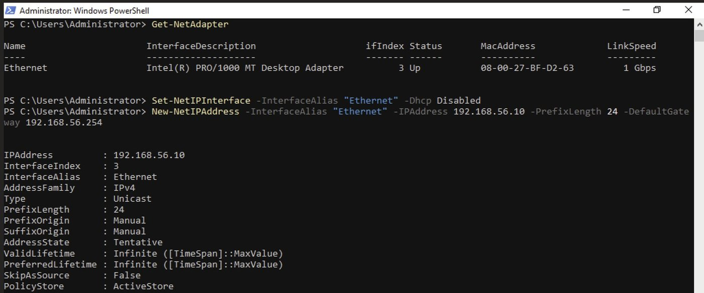

### 2. Bascule du DHCP de pfSense vers DC01

Ordre suivi, pour ne jamais avoir deux serveurs DHCP actifs en même temps :

1. Installer le rôle DHCP et l'autoriser dans l'AD.
2. Créer l'étendue **LAB-LAN** (192.168.56.100 à .150, bail de 2 h) **à l'état inactif**.
3. Définir les options : routeur 192.168.56.254, DNS 192.168.56.10, domaine `lab.internal`.
4. Réserver 192.168.56.104 pour Zabbix.
5. Désactiver le DHCP de pfSense sur le LAN.
6. Activer l'étendue, redémarrer Zabbix et vérifier son bail.

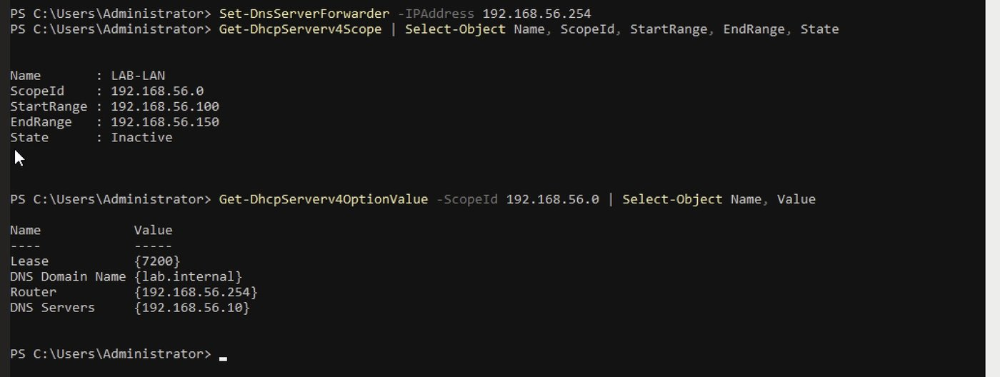

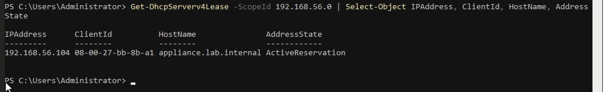

Zabbix a retrouvé son adresse, et la supervision de pfSense n'a pas été interrompue.

### 3. Annuaire : unités d'organisation, groupes, utilisateurs

| Unité d'organisation | Groupe global de sécurité | Utilisateur de test |
|---|---|---|
| ADMIN | GG_ADMIN | adm01 |
| RH | GG_RH | rh01 |
| INVITES | GG_INVITES | inv01 |

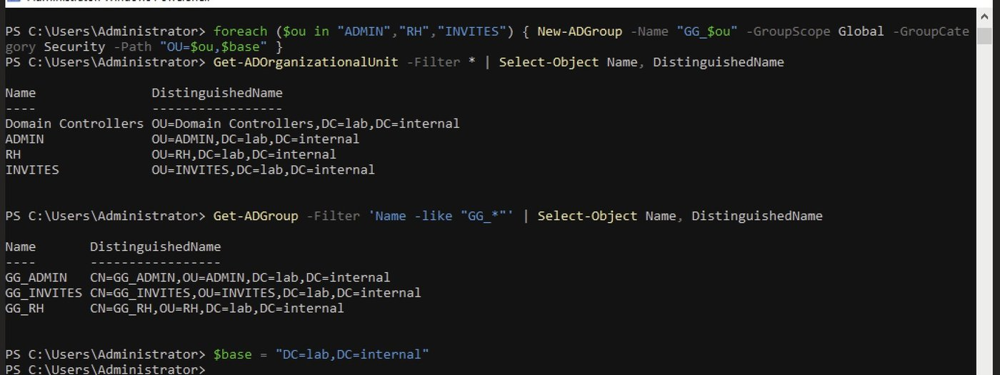

### 4. Partage `\\DC01\RH`

| Groupe | Partage (SMB) | NTFS |
|---|---|---|
| GG_ADMIN | Contrôle total | Contrôle total |
| GG_RH | Modification | Modification |
| Administrators, SYSTEM | — | Contrôle total |
| GG_INVITES et autres | Aucun | Aucun |

L'héritage est supprimé (`icacls /inheritance:r`) : seuls les groupes listés ont accès, selon le principe du moindre privilège.

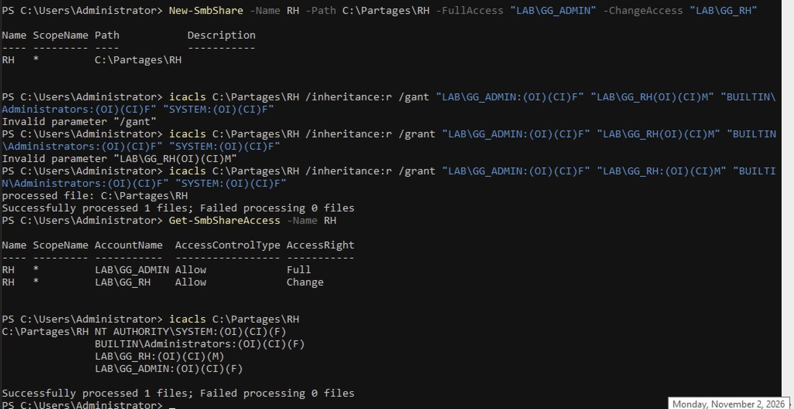

### 5. Stratégies de groupe

| Stratégie | Portée | Effet |
|---|---|---|
| Politique de mot de passe du domaine | Tout le domaine | 10 caractères minimum, complexité, verrouillage après 5 échecs pendant 15 min |
| `GPO_RH_Lecteur_R` | OU RH | Lecteur **R:** vers `\\DC01\RH` à l'ouverture de session (préférences, créée dans la console GPMC) |
| `GPO_INVITES_Panneau` | OU INVITES | Panneau de configuration bloqué (`NoControlPanel = 1`) |

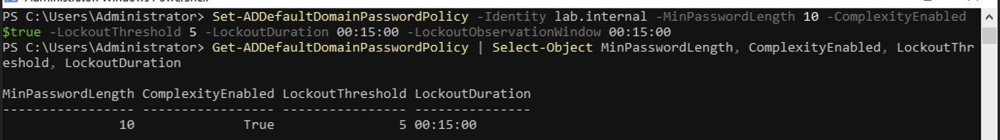

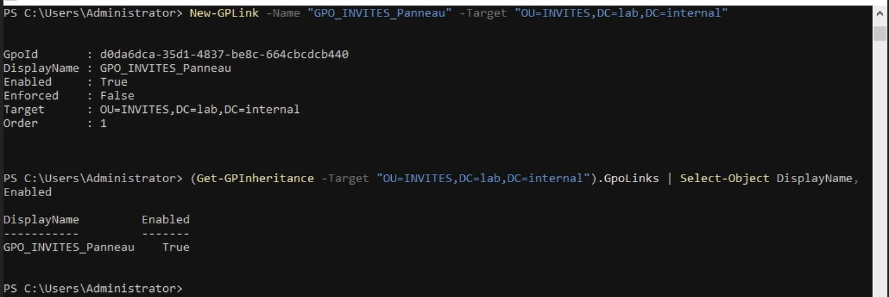

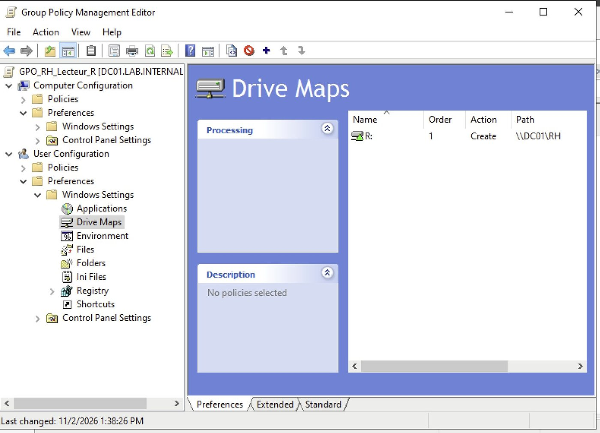

### 6. Poste client CLIENT01

La VM Windows 11 a EFI, TPM 2.0 et Secure Boot activés avant le premier démarrage. Elle reçoit sa configuration du DHCP de DC01, puis rejoint le domaine avec `Add-Computer`, après un test du port LDAP (`Test-NetConnection 192.168.56.10 -Port 389`).

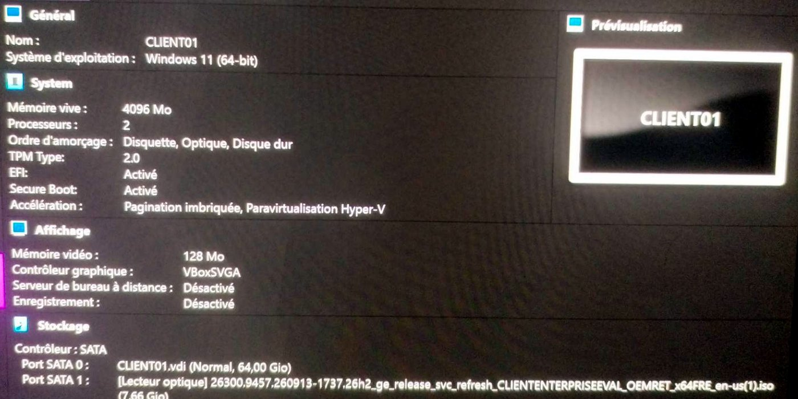

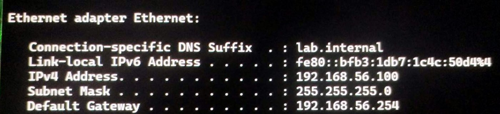

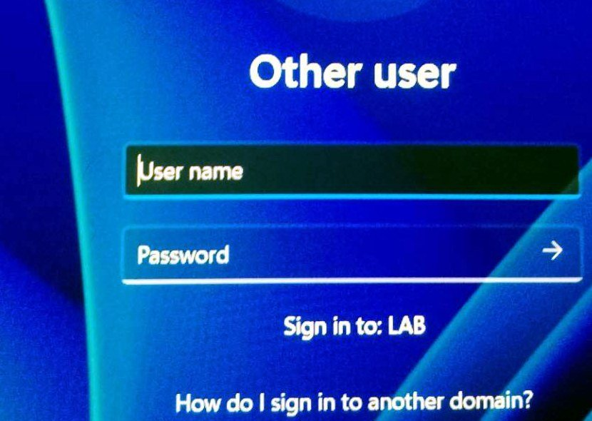

## Tests

| Test | Résultat |
|---|---|
| `rh01` : lecteur R: monté et écriture possible | OK |
| `inv01` : Panneau de configuration | Bloqué (« Restrictions ») |
| Mot de passe de 6 caractères | Refusé par le domaine |
| Verrouillage après 5 échecs | Configuré, non testé |

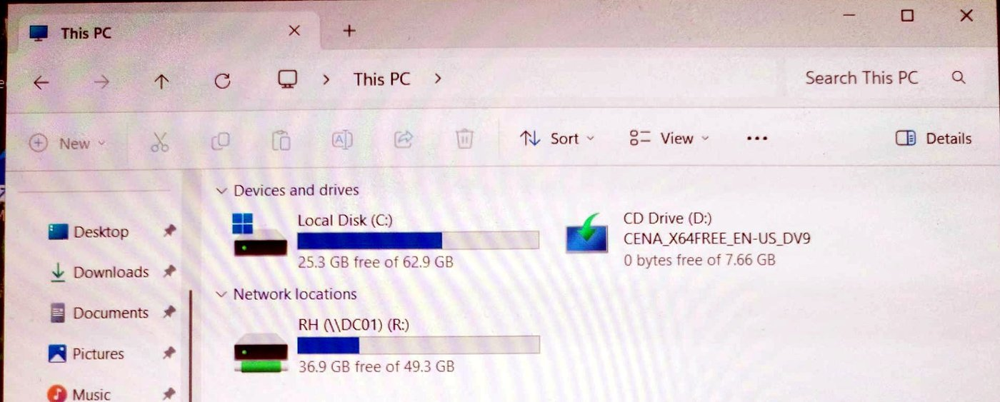

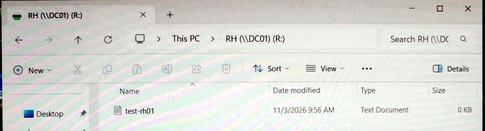

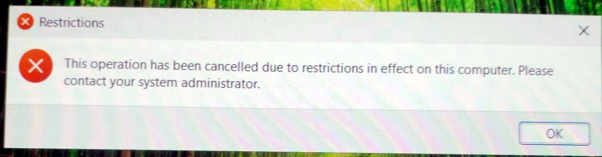

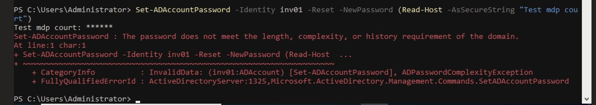

## Le problème le plus instructif

Le client n'arrivait pas à joindre le domaine : le DNS répondait, mais le port LDAP 389 de DC01 restait fermé. Sur DC01, les services étaient démarrés et le port en écoute, mais la carte réseau était classée **Private** au lieu de **DomainAuthenticated** : le pare-feu n'appliquait pas le profil « Domaine ». `Restart-NetAdapter` a fait reclasser la carte, et la jonction a réussi. Le détail est dans [Problèmes résolus](problemes-resolus.md).

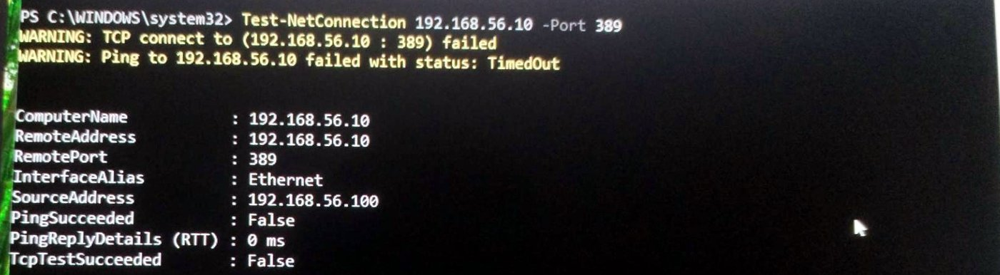

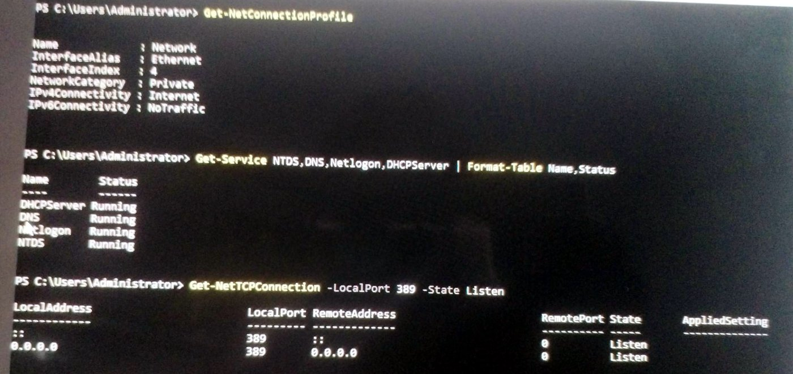

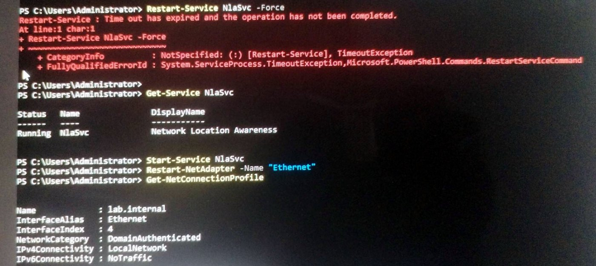

## Limites

- Après un redémarrage, le profil réseau de DC01 peut repasser en « Private ». Contournement : `Restart-NetAdapter -Name "Ethernet"`.
- Un seul contrôleur de domaine : aucune redondance.
- Licences d'évaluation à durée limitée.
- DC01 et CLIENT01 ne sont pas encore supervisés par Zabbix.

> Aucun mot de passe (administrateur, DSRM, comptes de test) ne figure dans ce dépôt : ils ont été saisis dans des invites masquées. Les photos d'écran ont été recadrées pour retirer les champs de mot de passe et le nom du compte local du client.
