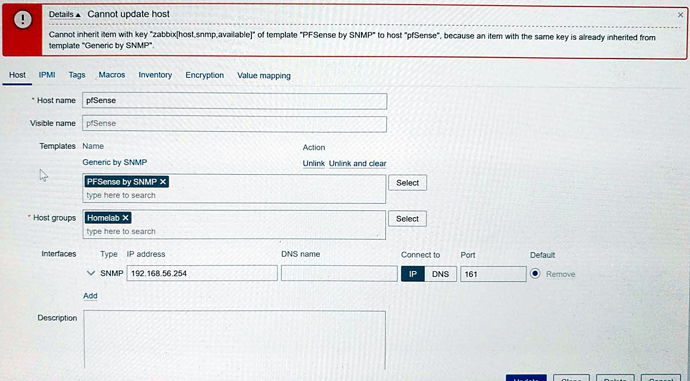
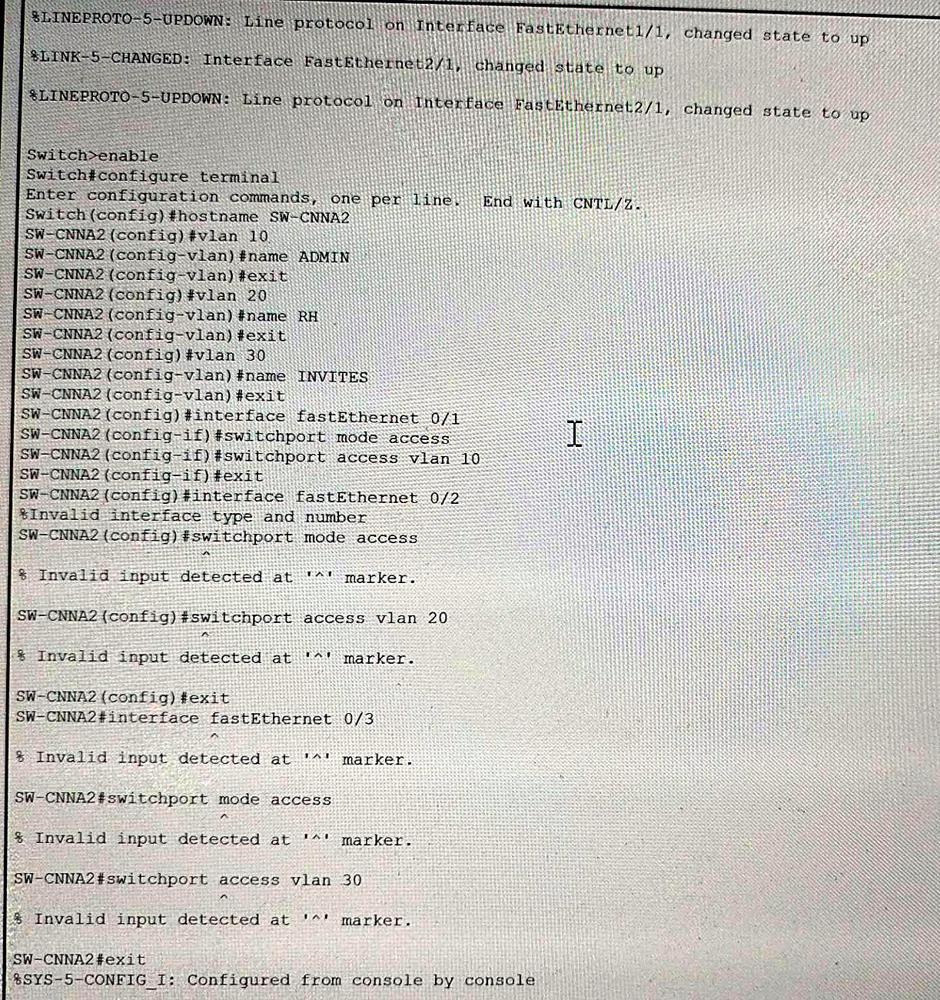

# Problèmes rencontrés et résolus

**Navigation :** [Accueil](../README.md) · [Partie A](partie-a-vlan.md) · [Partie B](partie-b-pfsense-zabbix.md) · [Adressage](plan-adressage.md) · [Règles pfSense](regles-pfsense.md) · [Tests et supervision](tests-et-supervision.md) · Problèmes résolus · [Feuille de route](feuille-de-route.md)

> Garder une trace des erreurs fait partie des objectifs du projet. Voici les problèmes rencontrés, avec le symptôme, la démarche de diagnostic et la solution.

## 1. Un trunk mal configuré sur le switch (partie A)

**Symptôme.** Une fois la configuration terminée, plus aucun ping ne passait, même entre un PC et sa propre passerelle.

**Diagnostic.** Vérification avec `show vlan brief` et `show interfaces trunk`. Le trunk était configuré sur le port Fa0/4, alors que le câble vers le routeur était branché sur Gi0/1.

**Solution.** Configurer le trunk sur le bon port, Gi0/1. Tout est rentré dans l'ordre.

**À retenir.** Avant de configurer un trunk, vérifier sur quel port le câble est réellement branché.

## 2. Un problème réseau pendant l'installation de pfSense (partie B)

**Symptôme.** L'installation échouait systématiquement, faute d'accès à Internet pour télécharger l'image du système.

**Diagnostic.** Un `ping 8.8.8.8` depuis le terminal de l'installeur a montré que c'était la passerelle NAT de VirtualBox elle-même qui renvoyait une erreur.

**Solution.** Passer l'interface WAN du mode NAT au mode Bridge, directement sur la carte Wi-Fi.

**À retenir.** Un test de ping simple depuis l'installeur permet de savoir si le problème vient de la machine ou du réseau.

## 3. Une règle de blocage sans effet (pfSense)

**Symptôme.** La règle bloquant le ping avait un compteur à 0/0 B. **Cause.** Elle était placée sous « Default allow LAN to any », évaluée en premier. **Solution.** La remonter au-dessus. **À retenir.** Ordre des règles = première correspondance gagnante.

## 4. Le blocage du ping coupait la supervision (pfSense / Zabbix)

**Symptôme.** Alerte « Unavailable by ICMP ping » juste après le blocage de l'ICMP. **Cause probable** (déduite de la chronologie, le journal n'a pas gardé de trace de ces paquets). La règle bloquait aussi le ping de Zabbix vers pfSense. **Solution.** Ajouter au-dessus une règle autorisant l'echo request vers « This Firewall ». L'alerte s'est résolue seule.

## 5. SNMP « timed out » après changement de communauté (Zabbix)

**Symptôme.** Hôte rouge après remplacement de la chaîne communautaire. **Cause.** Valeur de la macro différente de celle de pfSense, et interface de l'hôte encore sur `public`. **Solution.** Interface sur `{$SNMP_COMMUNITY}` et valeur copiée-collée depuis pfSense.

## 6. « Cannot update host » dans Zabbix

**Symptôme.** Erreur « Cannot inherit item with key zabbix[host,snmp,available]… already inherited from template Generic by SNMP ». **Cause.** Deux modèles liés à l'hôte, dont l'un embarque déjà l'autre. **Solution.** Ne garder que « PFSense by SNMP ».

## 7. Câbles de PC1 et PC2 inversés (Packet Tracer)

**Symptôme.** PC1 (VLAN 20) obtenait une adresse du VLAN 30. **Cause.** Mauvais ports du switch. **Solution.** Recâbler (PC1 sur Fa0/2, PC2 sur Fa0/3) puis `ipconfig /renew`.

## 8. Mauvais modèle de switch (Packet Tracer)

**Symptôme.** « Invalid interface type and number » puis commandes `switchport` rejetées. **Cause.** Le switch initial n'avait pas de ports Fa0/x. **Solution.** Remplacement par un 2960-24TT et recopie de la configuration.

## 9. Réseau Host-Only et DHCP de la VM Zabbix (VirtualBox)

**Constat.** L'appliance Zabbix prend 192.168.56.104 par DHCP (serveur .100) ; la plage DHCP du réseau Host-Only (.101 à .254) englobe l'adresse de pfSense (.254), et `VBoxManage list dhcpservers` indique « Enabled: No ». pfSense a aussi son propre serveur DHCP sur le LAN (plage .100 à .150), qui recouvre l'adresse .100 de celui de VirtualBox et l'adresse .104 de Zabbix. **À améliorer.** Créer une réservation DHCP pour la VM Zabbix (le tableau « Static Mappings » est vide) et ne garder qu'un serveur DHCP actif.

## 10. Ping de Zabbix vers Internet sans réponse (non résolu)

**Constat.** Zabbix perd 100 % des pings vers 8.8.8.8 et 1.1.1.1, alors que pfSense atteint 8.8.8.8 et que HTTP vers 1.1.1.1 répond. Une capture de paquets sur le WAN montre des requêtes ICMP sans réponse. **Cause non confirmée**, à investiguer.

## Aller plus loin

Le déroulé détaillé, avec toutes les captures, se trouve dans le [rapport PDF](../rapport/rapport-homelab-v1.pdf).
