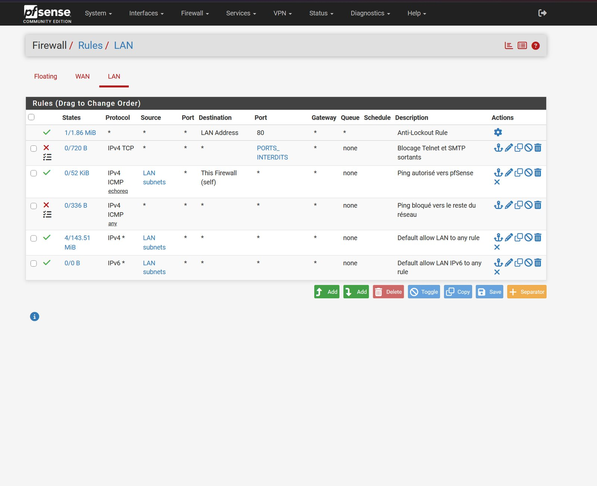
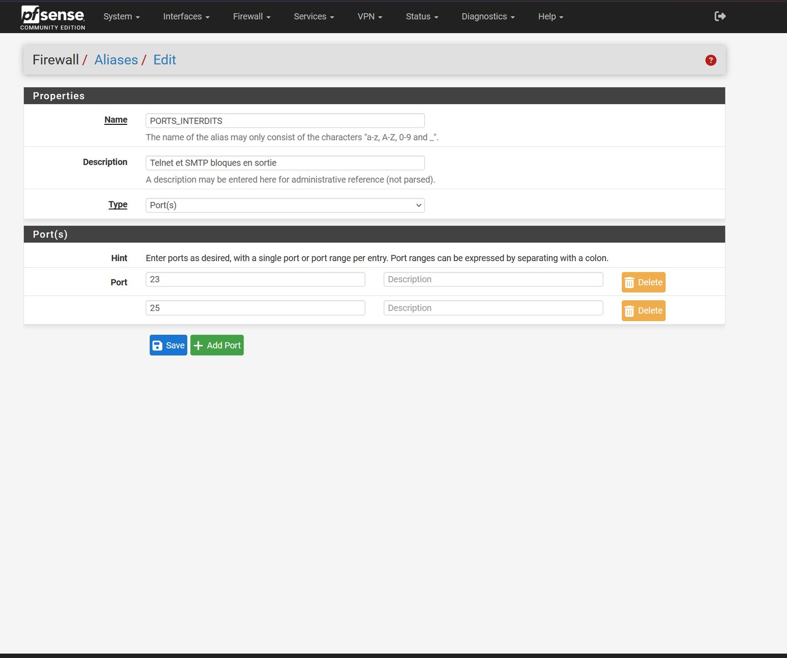
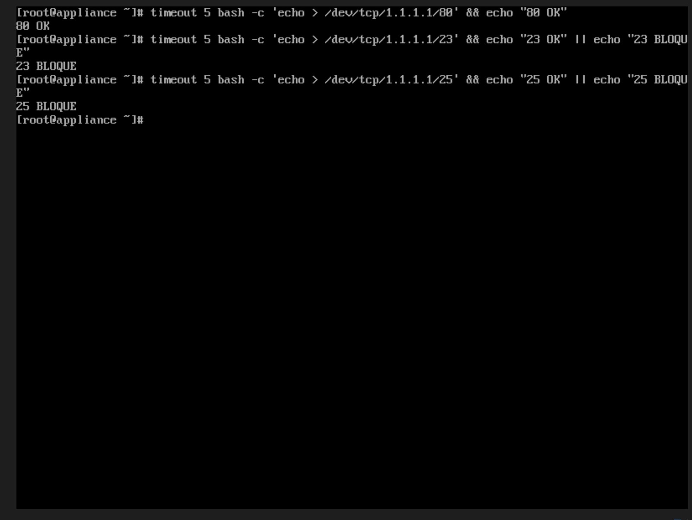
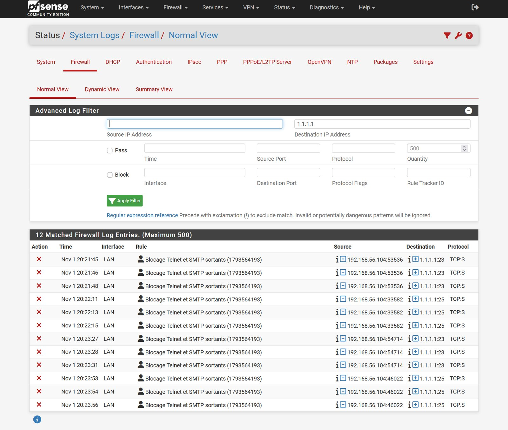
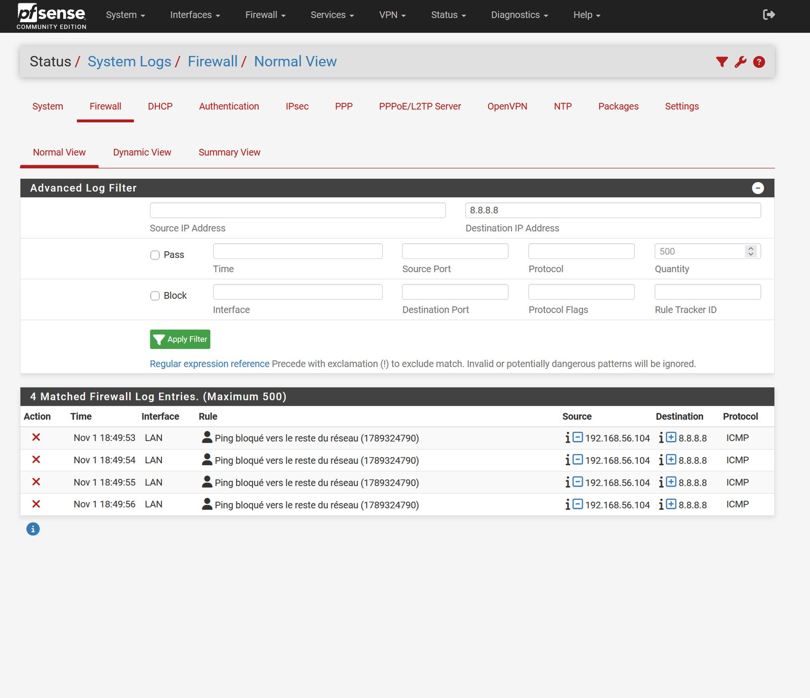

# Règles de filtrage pfSense

**Navigation :** [Accueil](../README.md) · [Partie A](partie-a-vlan.md) · [Partie B](partie-b-pfsense-zabbix.md) · [Adressage](plan-adressage.md) · Règles pfSense · [Tests et supervision](tests-et-supervision.md) · [Problèmes résolus](problemes-resolus.md) · [Feuille de route](feuille-de-route.md)

pfSense évalue les règles **de haut en bas** et applique la première qui correspond. L'ordre ci-dessous est donc voulu.

## Règles en place (interface LAN)

| # | Action | Protocole | Source | Destination | Description | Journalisée |
|---|---|---|---|---|---|---|
| 1 | Autoriser | * | * | LAN Address (80) | Règle anti-verrouillage (générée par pfSense) | Non |
| 2 | Bloquer | TCP | LAN | alias `PORTS_INTERDITS` | Blocage Telnet et SMTP sortants | Oui |
| 3 | Autoriser | ICMP (echo request) | LAN | This Firewall | Ping autorisé vers pfSense | Non |
| 4 | Bloquer | ICMP (tous types) | LAN | Tous | Ping bloqué vers le reste du réseau | Oui |
| 5 | Autoriser | IPv4 / IPv6 | LAN | Tous | Règles « Default allow LAN » | Non |

L'alias `PORTS_INTERDITS` regroupe les ports **23 (Telnet)** et **25 (SMTP)**.

## Pourquoi cet ordre

- Les règles de blocage doivent précéder « Default allow », sinon elles ne sont jamais atteintes (c'était le premier essai : compteur à 0/0 B).
- La règle 3 précède la règle 4 : sans elle, le blocage de l'ICMP coupait aussi le ping de Zabbix vers pfSense et déclenchait une alerte de disponibilité.

## Tests

| Test | Résultat |
|---|---|
| Depuis Zabbix : TCP 80 vers 1.1.1.1 | Passe |
| Depuis Zabbix : TCP 23 et 25 vers 1.1.1.1 | Bloqués (12 entrées dans le journal) |
| Depuis Zabbix : ping vers 8.8.8.8 | Bloqué et journalisé (4 entrées) |
| Depuis Zabbix : ping vers pfSense | Autorisé |

## Pistes suivantes

- Règles sur le WAN et filtrage entre sous-réseaux lorsque la partie A sera reliée à pfSense.
- Exporter la configuration de pfSense avant toute modification, sans jamais la publier telle quelle (elle peut contenir des secrets).
