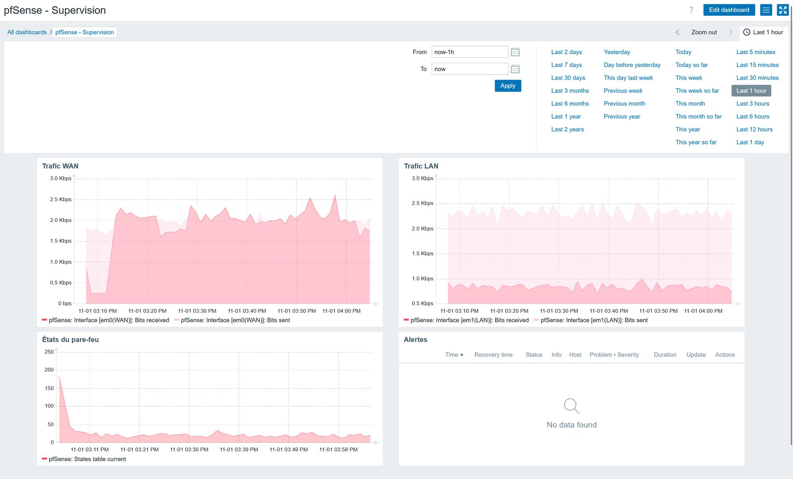
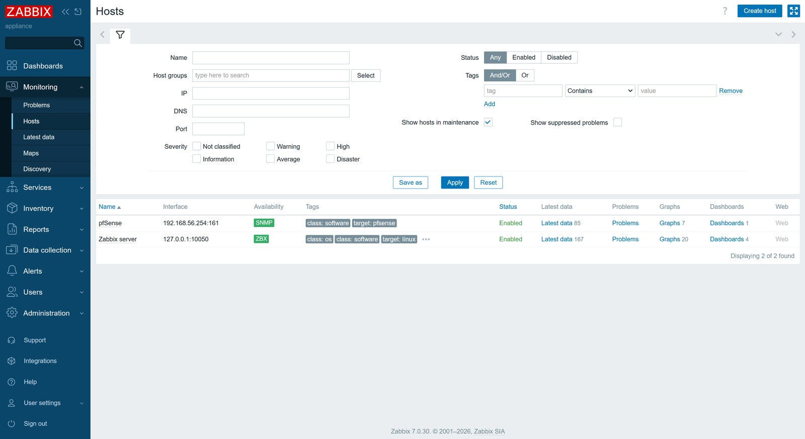
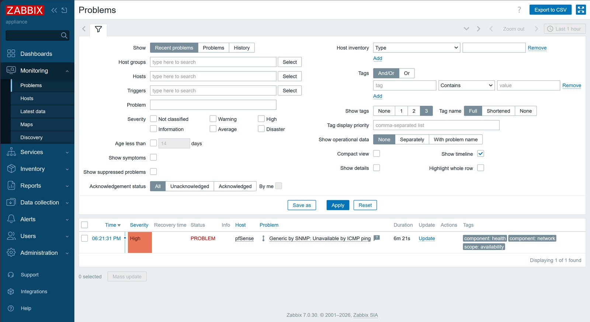
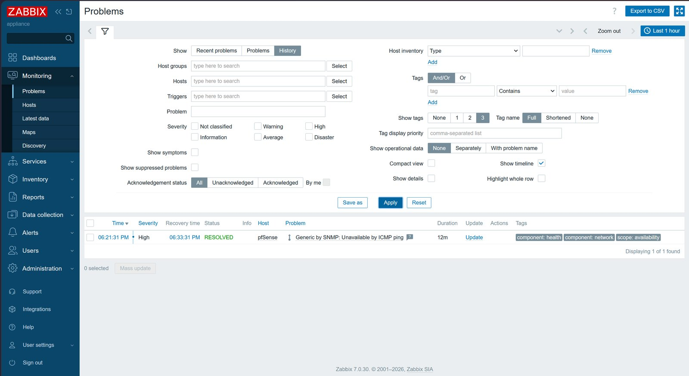

# Tests de connectivité et supervision

**Navigation :** [Accueil](../README.md) · [Partie A](partie-a-vlan.md) · [Partie B](partie-b-pfsense-zabbix.md) · [Adressage](plan-adressage.md) · [Règles pfSense](regles-pfsense.md) · Tests et supervision · [Problèmes résolus](problemes-resolus.md) · [Feuille de route](feuille-de-route.md)

## Tests réalisés

### Partie A — VLAN (Packet Tracer)

| Test | Commande ou action | Résultat attendu | Résultat obtenu | Statut |
|---|---|---|---|---|
| Affectation des ports aux VLAN | `show vlan brief` | Chaque port dans son VLAN | Conforme (capture de la page Partie A) | Réalisé |
| Transport des VLAN sur le trunk | `show interfaces trunk` | Les trois VLAN transportés vers le routeur | Conforme (capture de la page Partie A) | Réalisé |
| Routage inter-VLAN | `ping` entre deux PC de VLAN différents | Réponse reçue | Ping réussi (capture de la page Partie A) | Réalisé |
| Table de routage | `show ip route` sur le routeur | Trois réseaux directement connectés (code C) | Conforme (capture de la page Partie A) | Réalisé |
| ACL Invités vers Admin | `ping` du VLAN 30 vers le VLAN 10 | Pas de réponse | « Destination host unreachable » (capture de la page Partie A) | Réalisé |

### Partie B — pfSense et Zabbix (VirtualBox)

| Test | Commande ou action | Résultat attendu | Résultat obtenu | Statut |
|---|---|---|---|---|
| Accès à l'interface web de pfSense | Ouvrir http://192.168.56.254 depuis le PC hôte | Page de connexion | Accessible | Réalisé |
| Supervision SNMP | Hôte pfSense dans Zabbix | Disponibilité en vert | En vert, métriques en direct (captures de la page Partie B) | Réalisé |
| Règle de blocage ICMP | `ping 8.8.8.8` depuis Zabbix | Aucune réponse, blocage journalisé | Bloqué, 4 entrées au journal ([détails](regles-pfsense.md)) | Réalisé |
| Blocage Telnet / SMTP | `timeout 5 bash -c 'echo > /dev/tcp/1.1.1.1/23'` (et 25, et 80) | 23 et 25 bloqués, 80 ouvert | Conforme, 12 entrées au journal | Réalisé |
| Accès SSH restreint (partie A) | `ssh` depuis PC0 (VLAN 10) puis PC1 (VLAN 20) | Accepté, puis refusé | Conforme | Réalisé |
| Sortie vers Internet | HTTP vers 1.1.1.1 depuis Zabbix ; `ping 8.8.8.8` depuis pfSense | Accès fonctionnel | HTTP : « 301 Moved Permanently » ; ping depuis pfSense : 0 % de perte. Ping depuis Zabbix : 100 % de perte, **cause non confirmée** | Partiel |
| Résolution DNS | `nslookup` depuis une machine du LAN | Nom résolu | Non testé dans cette version | À faire |

## Supervision Zabbix

### Situation actuelle

pfSense est supervisé par l'appliance Zabbix 7.0 LTS via SNMP v2c, avec le modèle « PFSense by SNMP ». La chaîne communautaire est une valeur personnalisée stockée dans une macro de type « texte secret » ; pfSense n'écoute le SNMP que sur le LAN. Le tableau de bord affiche l'état de l'hôte et le trafic WAN/LAN.

### Alerte de disponibilité

Le déclencheur « Unavailable by ICMP ping » est passé en **PROBLEM** puis en **RESOLVED** (12 minutes) lorsque la règle de blocage ICMP a coupé, puis rétabli, le ping de Zabbix vers pfSense. Cet épisode a servi de test réel de l'alerte ; un arrêt volontaire de la VM n'a donc pas été nécessaire.

### Limites de cette version

- Aucun déclencheur sur la charge CPU : le modèle utilisé n'en fournit pas par défaut et aucun élément CPU n'a été configuré. Piste d'amélioration.

### Bonne pratique

La communauté SNMP par défaut est connue de tout le monde. Même dans un lab, utiliser une valeur personnalisée et ne jamais la publier dans ce dépôt public.
